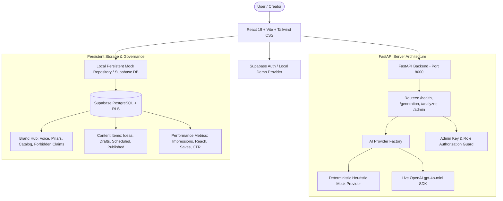

# ContentPilot AI — System Architecture & Design Specification

**Document Version:** 1.0.0  
**Date:** October 15, 2026  
**Status:** Approved & Implemented

---

## 1. System Overview

ContentPilot AI is an AI-powered social media creation, pre-publishing optimization, planning, and analytics platform built specifically for small businesses, creators, and social media managers.

The system bridges the historical gap between **traditional social media management (SMM) scheduling tools** (e.g., Buffer, Later, Hootsuite) and **creator packaging diagnostic tools** (e.g., vidIQ, TubeBuddy). It grounds all AI generation in a persistent **Brand Hub**, evaluates every draft across a **10-dimension Content Potential Analyzer**, organizes scheduled posts on a flexible **Content Calendar**, and suggests hypothesis-driven experiments from evidence-backed metrics.

---

## 2. Technology Stack

### Frontend Architecture
- **Framework:** React 19 + TypeScript + Vite 8
- **Styling:** Vanilla Tailwind CSS with custom design tokens (`tailwind.config.js`)
- **Typography:** Plus Jakarta Sans & JetBrains Mono via Google Fonts
- **Icons:** Lucide React
- **Animations:** Motion for React (`motion` package) with reduced-motion accessibility overrides
- **Routing:** React Router v7 (`react-router-dom`)
- **Data Visualizations:** Recharts (`ResponsiveContainer`, `BarChart`, `Bar`, `XAxis`, `YAxis`, `Tooltip`)
- **State & Data Access:** Local persistent repository (`storage.ts`) with seamless Supabase JS client integration (`@supabase/supabase-js`)

### Backend Architecture
- **Framework:** Python 3.14 + FastAPI
- **Data Validation:** Pydantic v2 schemas (`schemas.py`)
- **Server:** Uvicorn ASGI server
- **AI SDK:** Official OpenAI Python SDK (`openai>=1.50.0`)
- **Testing:** Pytest + pytest-asyncio + httpx
- **Security:** Server-side verified `X-Admin-Key` authorization guard on privileged owner-admin endpoints

---

## 3. Cohesive Visual Identity System

The visual identity is designed to feel editorial, warm, and distinctly human, eschewing generic AI neon gradients or floating glassmorphism blobs:

- **Primary Background:** Warm Ivory (`#F6F5F1`)
- **Surfaces & Panels:** Pure White (`#FFFFFF`) with subtle panel shadows
- **Main Typography & Accents:** Ink Navy (`#202D46`)
- **Primary Action Accent:** Cobalt (`#3457F1`) with hover state (`#2544D4`)
- **Rare Highlight Accent:** Chartreuse (`#D9F078`) — used strictly for high-visibility badges and differentiators
- **Dividers & Borders:** Soft Stone (`#E8E7E1`)
- **Semantic Feedback:**
  - Success / High Readiness: Accessible Teal (`#0E9F6E` / bg: `#DEF7EC`)
  - Warning / Moderate: Muted Amber (`#D97706` / bg: `#FEF3C7`)
  - Error / Weak: Muted Red (`#DC2626` / bg: `#FEE2E2`)

---

## 4. Key Differentiator: The Content Potential Analyzer

Inspired by research into packaging diagnostics (vidIQ AI Coach, TubeBuddy Thumbnail Analyzer), the Content Potential Analyzer evaluates 10 qualitative dimensions before content is scheduled or published:

1. **Hook Strength (First 3 Seconds / Line 1):** Scans for curiosity loops, numbers, unexpected conflicts, and eliminates passive throat-clearing ("In this post...", "Check out my...").
2. **Audience Relevance:** Matches messaging against defined customer personas in the Brand Hub.
3. **Curiosity & Retention Structure:** Analyzes paragraph rhythm, line-length variation, and bullet-point scannability.
4. **Clarity & Readability:** Evaluates word density and mobile screen real estate.
5. **Emotional Resonance:** Detects authentic friction, vulnerability, and craft passion.
6. **Shareability & Save-Worthiness:** Assesses bookmark utility (cheat sheets, recipes, frameworks).
7. **CTA Clarity:** Verifies presence of a single, low-friction next step.
8. **Brand Voice Consistency:** Flags deviations from tone boundaries.
9. **Originality & Repetition:** Flags corporate buzzwords and clichéd platitudes.
10. **Visual Concept:** Evaluates the synergy between text and accompanying image/video shots.

**Ethical Principle:** The analyzer score is transparently presented as an *editorial heuristic assessment*, never an unsubstantiated "guarantee of virality."

---

## 5. Security & Authorization Model

1. **Client-Side vs Server-Side Separation:**
   - Frontend state or localStorage manipulation **cannot** grant owner admin access.
   - All administrative actions (`/admin/metrics`, `/admin/users`, `/admin/plans`) enforce server-side header verification (`X-Admin-Key` or verified JWT claims).
2. **Data Isolation:**
   - Supabase Row Level Security (RLS) policies enforce that users can only select, insert, update, or delete records where `auth.uid()` belongs to the associated `workspace_id`.
3. **Safe Offline Demo Mode:**
   - Evaluators and developers can run the entire frontend and backend locally with rich pre-seeded data without requiring live credit cards or paid API keys.
   - When `OPENAI_API_KEY` is added to `.env`, the backend automatically transitions to live OpenAI model completions.
